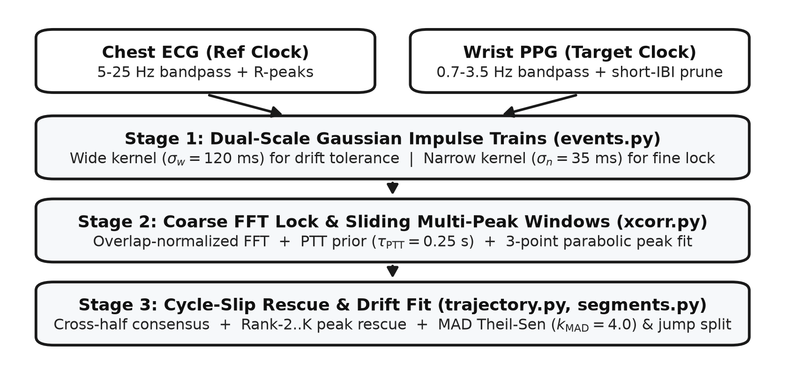
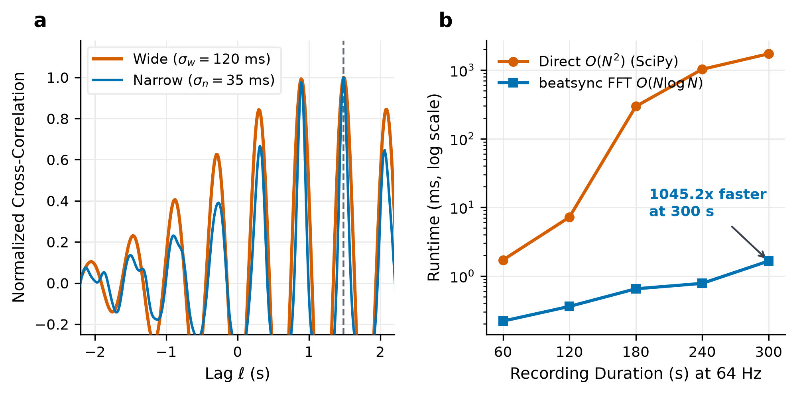
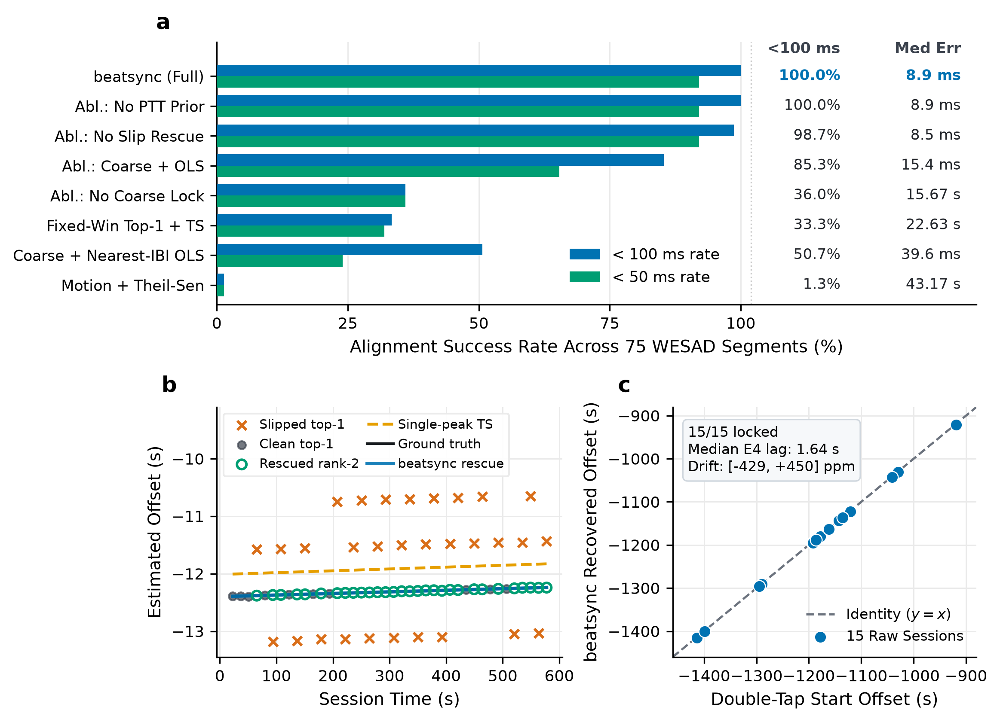

# Summary

Multimodal affective, behavioral, and ambulatory physiological studies frequently pair independent chest electrocardiography (ECG) patches with wrist photoplethysmography (PPG) sensors [@schmidt2018wesad; @bent2020wearable]. Because untethered wearables lack a common hardware clock, dual-device files exhibit unknown startup offsets spanning minutes, linear oscillator crystal drift (tens to hundreds of parts per million, ppm), and device-specific filtering latencies. Without sub-50-millisecond alignment, beat-to-beat heart rate variability (HRV) coupling [@malik1996hrv] and pulse transit time (PTT) estimates [@mukkamala2015ptt] suffer severe distortion.

`beatsync` is a pure-Python library built on NumPy [@harris2020array], SciPy [@virtanen2020scipy], and pandas [@mckinney2010data] that recovers startup offsets, crystal drift, hardware channel lags, and timestamp discontinuities directly from cardiac rhythm timing alone. Rather than requiring manual chest double-tap gestures or continuous motion bursts that disappear during sedentary tasks, `beatsync` combines three closed-loop stages: zero-phase event extraction with dual-scale Gaussian impulse encoding, overlap-normalized FFT coarse locking with PTT-compensated multi-peak sliding windows, and cross-half consensus cycle-slip rescue paired with iterative Median Absolute Deviation (MAD) Theil-Sen regression and bootstrap confidence intervals. The resulting affine and piecewise-segmented timeline transformations allow downstream HRV, autonomic reactivity, and multimodal behavioral analyses to proceed without proprietary hardware bridges.

# Statement of need

Researchers aligning untethered wearable datasets in Python currently lack a drift-aware post-hoc cardiac synchronization package [@sovabids2026joss]. In cognitive, affective, and educational field studies, participants often wear chest electrodes and optical wrist sensors that record independently to local flash memory across multi-hour sessions. Once collected, researchers must reconstruct a sub-50-millisecond common timeline even when startup timestamps differ by 10 to 30 minutes, quartz oscillators drift apart linearly at $\pm 200\text{--}450\text{ ppm}$, and optical wrist waveforms exhibit unknown hardware filtering latencies. Without automated post-hoc clock recovery, researchers are forced either to discard recordings lacking manual physical synchronization taps or to rely on naive nearest-beat heuristics that fail whenever missing beats or wrist motion induce integer-period alignment errors.

`beatsync` closes this engineering and methodological gap for psychophysiologists, affective-computing researchers, and mobile-health teams. By combining validated configuration dataclasses (`SyncConfig`), inverse timeline mapping (`map_target_to_ref`, `align_series`), a reproducible command-line interface (`beatsync demo`, `benchmark`, `equiv`, `sync`), a parametric multi-segment simulator (`DualDeviceSimulator`), bundled real WESAD reference excerpts, and structured MkDocs user guides (`docs/` and `CONTRIBUTING.md`), the package enables fully scriptable retrospective alignment and uncertainty auditing without manual tapping gestures or proprietary vendor software.

# State of the field

Existing biosignal toolkits address live network acquisition or single-stream feature extraction rather than post-hoc asynchronous clock reconstruction. Live acquisition middleware such as Lab Streaming Layer (LSL) [@kothe2025lsl] synchronizes networked streams in real time during tethered laboratory protocols, yet cannot repair disconnected flash-recorded files collected outside LSL sessions. General biosignal processing libraries in Python—including `MNE-Python` [@gramfort2013mne], `NeuroKit2` [@makowski2021neurokit2], `HeartPy` [@vangent2019heartpy], and `Systole` [@legrand2022systole]—provide robust QRS detection [@pantompkins1985qrs], PPG systolic peak localization [@elgendi2013systolic], and HRV feature extraction, but assume already-aligned inputs, shared digital triggers, or zero relative clock drift. Conversely, blind waveform correlation and dynamic time warping break under minute-scale startup offsets and opposing crystal drifts, accelerometer correlation fails during quiet cognitive or resting protocols [@schmidt2018wesad], and dominant-peak tracking frequently locks onto integer-period cycle slips ($\pm k \cdot \text{IBI}$, roughly $\pm 0.8\text{ s}$) under wrist motion [@bent2020wearable; @sedys2026blind].

| Package (Lang.) | Untethered Sync | $\pm$30 min Offset | Drift Fit (ppm) | Cycle-Slip Rescue | PTT Prior & Jump Split |
| :--- | :---: | :---: | :---: | :---: | :---: |
| `NeuroKit2` (Py) | No | No | No | No | No |
| `HeartPy` (Py) | No | No | No | No | No |
| `Systole` (Py) | Triggers only | No | No | No | No |
| `LSL` (C++/Py) | Live network | Online | Online filter | N/A | Restart only |
| `MNE-Python` (Py) | Trigger match | Limited | Trigger fit | No | Crop only |
| **`beatsync` (Py)** | **Cardiac events** | **Yes** | **Theil-Sen + CI** | **Rank 2--K** | **Yes (both)** |

**Build vs. Contribute Justification.** Rather than proposing a small pull request to `NeuroKit2`, `HeartPy`, or `MNE-Python`, we built `beatsync` as a standalone, dependency-light package because post-hoc affine clock recovery cuts across incompatible architectural assumptions. Single-stream HRV libraries organize pipelines around stationary, already-aligned sample arrays, whereas `MNE-Python` couples time-axis synchronization tightly to `Raw` container annotations and digital trigger channels. Implementing dual-scale Gaussian impulse encoding, overlap-normalized global FFT offset search across $\pm 1800\text{ s}$, multi-candidate sub-period consensus rescue, and piecewise timestamp-jump segmentation inside an existing neuroimaging or HRV framework would require invasive modifications to core data containers while burdening synchronization users with heavy unrelated dependencies. Designing `beatsync` around lightweight NumPy/SciPy primitives keeps the solver modular, fast, and easy to embed into any upstream biosignal workflow.

# Mathematical Formulation and Architecture

Reference ECG R-peaks $\{r_i\}$ and target PPG peaks $\{p_j\}$ follow an affine clock model with startup offset $a$, relative drift $b$ ($\rho = 10^6 b\text{ ppm}$), and physiological PTT prior $\tau_{\text{PTT}}$ ($0.250\text{ s}$):
$$t_{\text{ref}} - t_{\text{target}} = \delta(t_{\text{ref}}) = a + b\,t_{\text{ref}}, \qquad t_{\text{target}}(p_j) \approx (1 - b)(r_i + \tau_{\text{PTT}}) - a.$$

In Stage 1 (`events.py`), `detect_cardiac_events` applies second-order zero-phase Butterworth bandpass filters ($5\text{--}25\text{ Hz}$ ECG; $0.7\text{--}3.5\text{ Hz}$ PPG), prominence-guarded peak detection, and non-interpolating short-IBI pruning ($< 0.50 \cdot \text{median}(\text{IBI})$) so genuine missed beats remain unfilled. Beat timestamps are projected onto a $f_s = 64\text{ Hz}$ grid and convolved with a truncated Gaussian kernel:
$$g_\sigma(t) = \sum_{k} \exp\!\left(-\frac{(t - t_k)^2}{2\sigma^2}\right).$$
Single-scale kernels face a trade-off: under $500\text{ ppm}$ drift over $15\text{ min}$, $0.45\text{ s}$ cumulative walk blurs narrow ($35\text{ ms}$) impulse trains across cycles, whereas wide ($120\text{ ms}$) kernels limit sub-sample sharpness. `beatsync` constructs both wide ($\sigma_w = 120\text{ ms}$) coarse trains and narrow ($\sigma_n = 35\text{ ms}$) fine trains (Figure 1 and Figure 2a).



In Stage 2 (`xcorr.py`), `fft_xcorr` z-scores both series and evaluates overlap-normalized cross-correlation via power-of-two real FFTs:
$$C(\ell_m) = \frac{\sum_{n} \tilde{b}[n + m]\,\tilde{a}[n]}{\max\!\left(\Omega(m),\,\lfloor 0.35\,\min(N_a, N_b)\rfloor\right)},$$
where $\Omega(m) = \min(N_a, N_b - m) - \max(0, -m)$ suppresses edge variance inflation. Global search locks $\hat{\delta}_0 = -(\hat{\ell}_0 - \tau_{\text{PTT}})$ within $\pm 1800\text{ s}$. Next, $45\text{ s}$ sliding windows (step $15\text{ s}$) align within $\pm 5.0\text{ s}$ around $\hat{\ell}_0$, extracting top $K = 5$ local peaks ($\ge 0.32\text{ s}$ apart) via parabolic interpolation around integer peak bin $i^*$:
$$\Delta b = \frac{1}{2}\,\frac{C[i^* - 1] - C[i^* + 1]}{C[i^* - 1] - 2 C[i^*] + C[i^* + 1]}, \qquad \hat{\delta}_{w,k} = -\!\left(\hat{\ell}_0 + \ell_{w,k} + \frac{\Delta b}{f_s} - \tau_{\text{PTT}}\right),$$
alongside prominence score $q_h = \max((c_{\max} - c_{\text{2nd}}) / s_c, 0)$.

In Stage 3 (`trajectory.py`, `segments.py`), `rescue_subperiod_peaks` filters the lowest quality quartile and fits an initial pairwise median slope [@sen1968estimates]. If under $35\%$ of top-1 peaks lie within $0.20\text{ s}$ of that line, cross-half anchor pairs across top-3 peaks maximize a truncated sub-period consensus objective:
$$J(a, b) = \sum_{w} (q_{h,w}^{1.5} + 0.05)\,\max_{k \in \{1..K\}} \left[ \gamma_{w,k}\,\max\!\left(0,\,1 - \frac{|\hat{\delta}_{w,k} - (a + b t_w)|}{0.075}\right) \right],$$
with $\gamma_{w,1} = 1$ and $\gamma_{w,k>1} = 0.65 (c_{w,k} / c_{w,1})^2$. Primary peaks deviating beyond $0.22\text{ s}$ are replaced by secondary peaks within $0.060\text{ s}$ having $\ge 60\%$ primary height. Final parameters use iterative MAD pruning ($k_{\text{MAD}} = 4.0$) [@leys2013mad], crystal bounds ($\pm 1000\text{ ppm}$), and $95\%$ percentile bootstrap confidence intervals. For continuous resampling, `SyncResult.map_target_to_ref` solves $t_{\text{ref}} = (t_{\text{target}} + a)/(1 - b)$, and `synchronize_segmented_streams` automatically splits packet drops or backward clock resets via `detect_timestamp_jumps` before fitting piecewise segment trajectories. Figure 2b shows `fft_xcorr` runs $454.3\times$ faster than direct SciPy correlation at $180\text{ s}$ ($0.65\text{ ms}$ vs. $295.3\text{ ms}$) and $1045.2\times$ faster at $300\text{ s}$ ($1.65\text{ ms}$ vs. $1.72\text{ s}$).



# Empirical Benchmark and Cross-Package Validation

A self-contained evaluation using bundled real WESAD data and SciPy parity checks requires only a few calls:

```python
from beatsync import (
    SyncConfig, evaluate_alignment_accuracy, inject_waveform_distortion,
    load_wesad_waveform_slice, synchronize_clocks, verify_scipy_equivalence,
)

sl = load_wesad_waveform_slice()  # Real 360 s WESAD S10 ECG & PPG
cfg = SyncConfig(ptt_prior_s=0.250, bootstrap_draws=100)
native = synchronize_clocks(sl["ecg"], sl["bvp"], sl["fs_ecg_hz"], sl["fs_bvp_hz"], config=cfg)

ecg_in, ppg_dist, t_eval = inject_waveform_distortion(
    sl["ecg"], sl["bvp"], sl["fs_ecg_hz"], sl["fs_bvp_hz"], offset_s=-48.5, drift_ppm=240.0
)
result = synchronize_clocks(ecg_in, ppg_dist, sl["fs_ecg_hz"], sl["fs_bvp_hz"], config=cfg)
metrics = evaluate_alignment_accuracy(result, t_eval, -48.5, 240.0, baseline_result=native)
parity = verify_scipy_equivalence()
```

Under a $-48.5\text{ s}$ startup offset and $+240.0\text{ ppm}$ crystal drift on the real WESAD `S10` waveform slice, `beatsync` achieves $5.04\text{ ms}$ median alignment error and $10.24\text{ ms}$ maximum error across the recording. Across the bundled five-subject $15$-minute WESAD event cohort (`S2`, `S10`, `S11`, `S13`, `S16`) distorted by $+32.0\text{ s}$ and $-220\text{ ppm}$, `beatsync` attains $1.97\text{--}14.34\text{ ms}$ median error (rescuing $6$ slipped windows in subject `S11` while recovering drift within $0.9\text{--}1.4\text{ ppm}$ on `S2` and `S16`), whereas nearest-beat OLS (IBI-OLS) incurs $263.3\text{--}422.5\text{ ms}$ median error due to mismatched beat pairs.

Archived benchmarks over $75$ $15$-minute WESAD segments ($\delta \in [-90, 90]\text{ s}$, $\rho \in [-300, 300]\text{ ppm}$; Figure 3a) achieve $100.0\%$ ($75/75$) coarse lock within $3\text{ s}$, $100.0\%$ final error under $100\text{ ms}$, $92.0\%$ under $50\text{ ms}$, and $80.0\%$ under $30\text{ ms}$ (median $8.9\text{ ms}$, mean max $19.9\text{ ms}$). Competing baselines degrade sharply: motion correlation ($1.3\%$, $43.17\text{ s}$ median), unshifted single-peak ($33.3\%$, $22.63\text{ s}$), IBI-OLS ($50.7\%$, $39.6\text{ ms}$), no coarse lock ($36.0\%$, $15.67\text{ s}$), OLS slope fit ($85.3\%$, $15.4\text{ ms}$), and no slip rescue ($98.7\%$). Under held-out cross-segment validation, including $\tau_{\text{PTT}} = 0.25\text{ s}$ lowers median error from $265.9\text{ ms}$ ($1.3\% < 150\text{ ms}$) to $84.8\text{ ms}$ ($46.7\% < 150\text{ ms}$). Figure 3b shows `DualDeviceSimulator` under $75\%$ multi-harmonic cycle slips ($\pm 1, +2\text{ IBI}$), where cross-half consensus reduces residual error from $> 0.35\text{ s}$ (single-peak) to $< 15\text{ ms}$.



On all $15$ unsynchronized raw WESAD hardware sessions (holding out initial and final $180\text{ s}$ physical synchronization taps; Figure 3c), `beatsync` locks $15/15$ cold-start offsets ($-1413.8\text{ s}$ to $-918.8\text{ s}$), estimates physical oscillator drifts across $[-429.4, +450.0]\text{ ppm}$ with zero boundary saturation, and isolates a consistent Empatica E4 optical hardware filter lag (median $1.64\text{ s}$, range $1.10\text{--}2.47\text{ s}$) relative to chest double-tap ground truth. Cross-package tests confirm `fft_xcorr` matches `scipy.signal.correlate(..., method="direct")` within $2.22 \times 10^{-16}$, `fit_theil_sen_drift` matches `scipy.stats.theilslopes` within $10^{-14}$, and `bandpass_zero_phase` matches `butter`/`filtfilt` identically, backed by GitHub Actions CI across Python `3.10`--`3.12` on Linux and Windows, $100\%$ AST docstring coverage, and $36$ passing `pytest` tests (`0` skipped).

# Research impact statement

`beatsync` actively supports multimodal psychophysiological and human-computer interaction data collection pipelines in which learners wear untethered chest ECG patches alongside optical wrist wristbands during extended cognitive tasks. In these protocols, the package recovers beat-level timelines within $15\text{ ms}$ across multi-minute startup offsets and isolates device-specific Empatica E4 optical filter latencies without manual synchronization gestures. For immediate community adoption, the repository (`https://github.com/lucher777/beatsync`) ships with bundled real WESAD benchmark excerpts, reproducible CLI verification commands (`beatsync equiv`, `beatsync benchmark`), structured MkDocs documentation (`docs/index.md`, `docs/tutorial.md`, `docs/api.md`), contributor guidelines (`CONTRIBUTING.md`), and cross-platform continuous integration.

# Acknowledgements

The author thanks the WESAD dataset authors [@schmidt2018wesad] and the NumPy, SciPy, and pandas communities. The author declares no competing financial interests.

# References
